# ManakMitra

**Evidence-grounded assistant for Indian Standards and BIS services.**

[](https://www.sih.gov.in)
[](#team)
[](https://forest-yonder-apex-plum.vercel.app/)
[](LICENSE)

> Lock-first → retrieve-second → ground → **Allow / Clarify / Refuse**.  
> Public catalogue **metadata** only. No paid clause text. No invented fees.

**Smart India Hackathon 2026** · Problem statement **SIH26107**  
Ministry of Consumer Affairs, Food & Public Distribution · Theme: Smart Automation · Team ID **175176**

| Live MVP | Demo | Repo | Architecture |
| --- | --- | --- | --- |
| [Vercel](https://forest-yonder-apex-plum.vercel.app/) | [YouTube](https://www.youtube.com/watch?v=oi7lZYGw1Uw) | [github.com/owais265/ManakMitra](https://github.com/owais265/ManakMitra) | [gitdiagram](https://gitdiagram.com/owais265/manakmitra) |

This is **not** an official website of BIS or the Government of India. Always re-check the live portal before you apply, pay, or file.

## Live product — screenshots from Vercel (2026-10-30)

Home, assistant, and desks from the production deploy. The assistant screenshots show real Allow, Clarify, and Refuse exits.

| Home | Assistant — PET bottles (Allow) | Assistant — fan + HUID (Refuse) |
| --- | --- | --- |
| 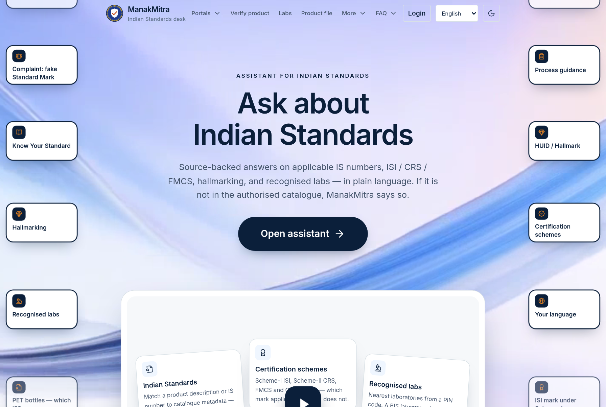 | 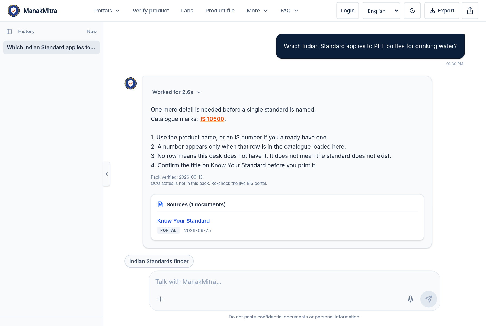 | 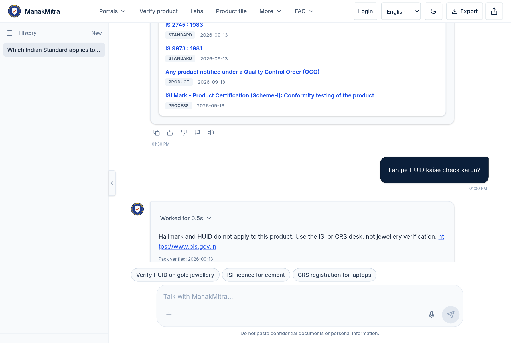 |

| Assistant empty | Helmet (Clarify) | Login |
| --- | --- | --- |
| 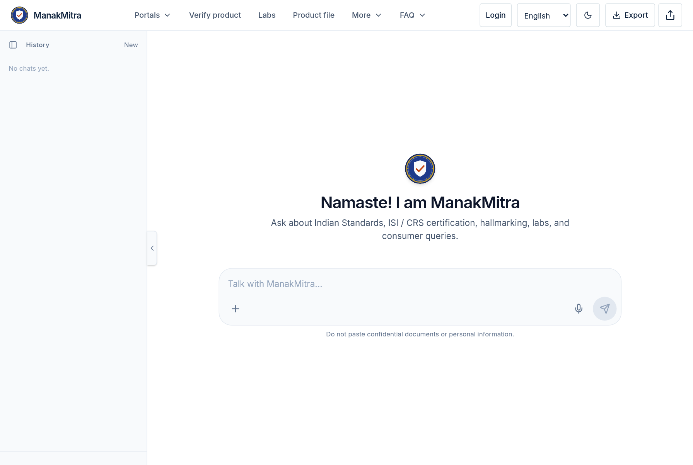 | 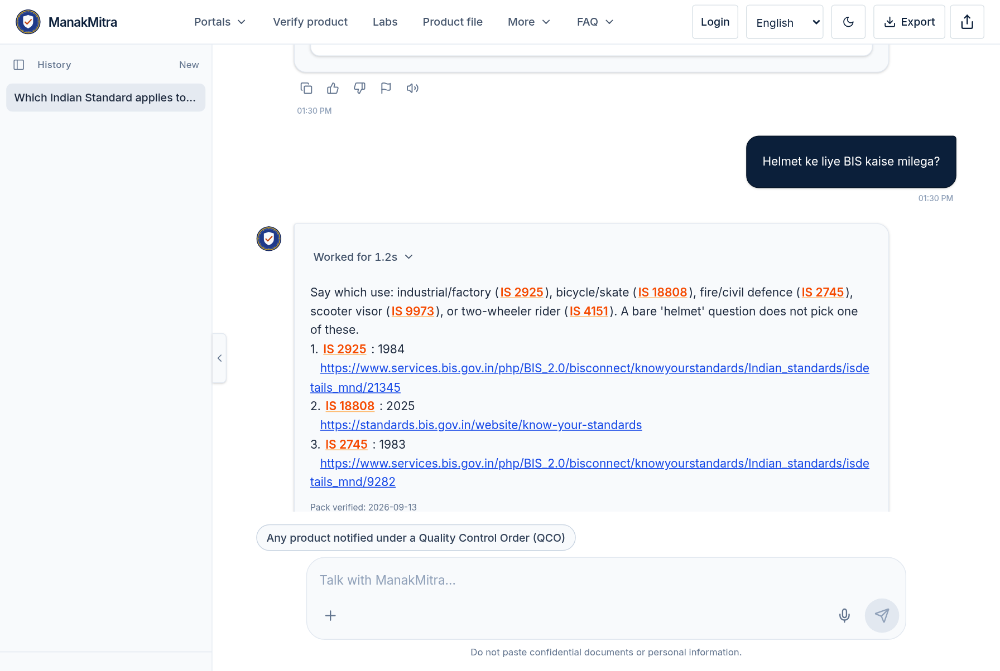 | 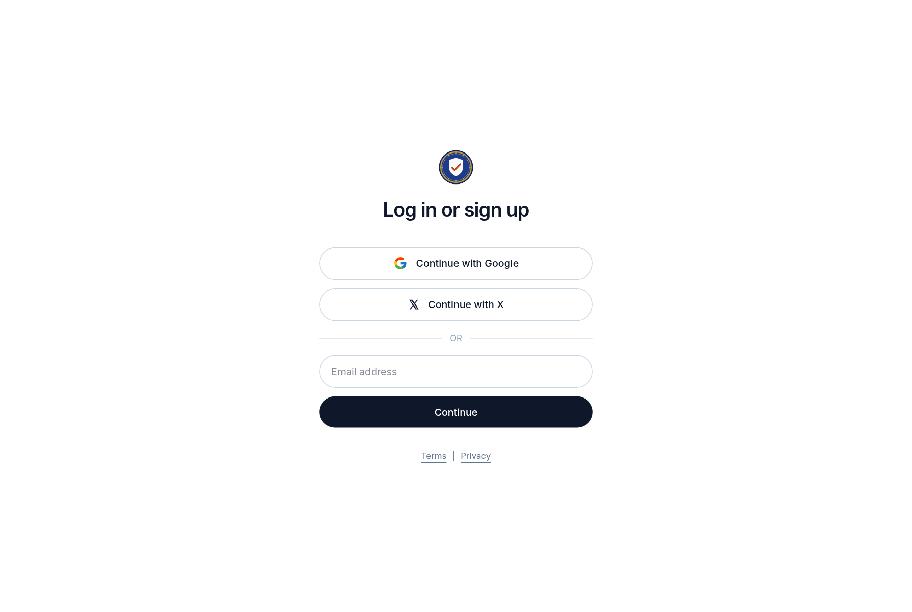 |

| Labs | Verify | HUID | Standards | Hallmark |
| --- | --- | --- | --- | --- |
| 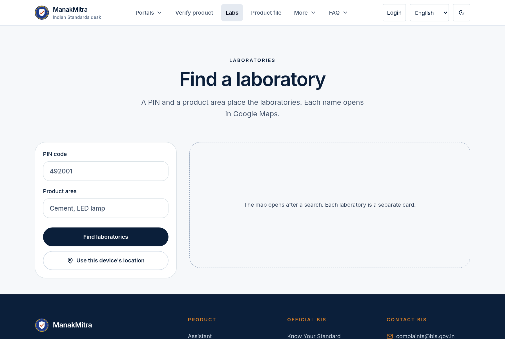 | 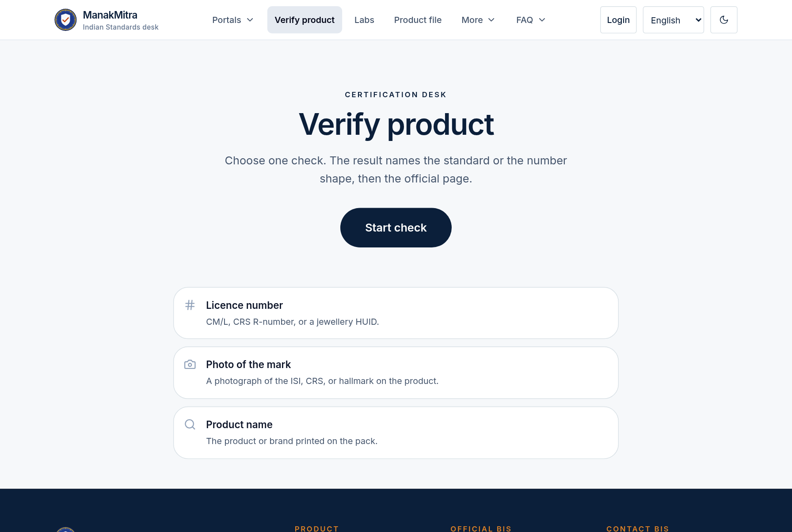 | 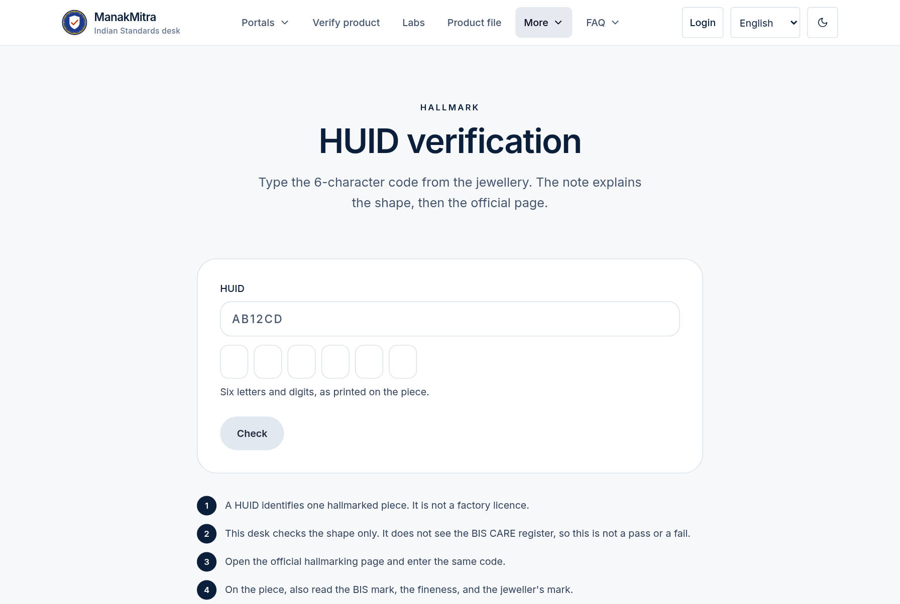 | 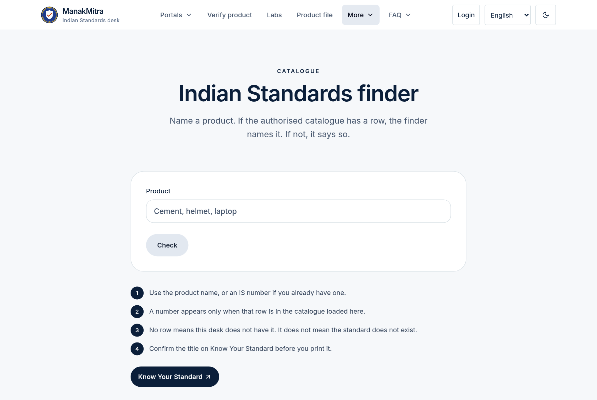 | 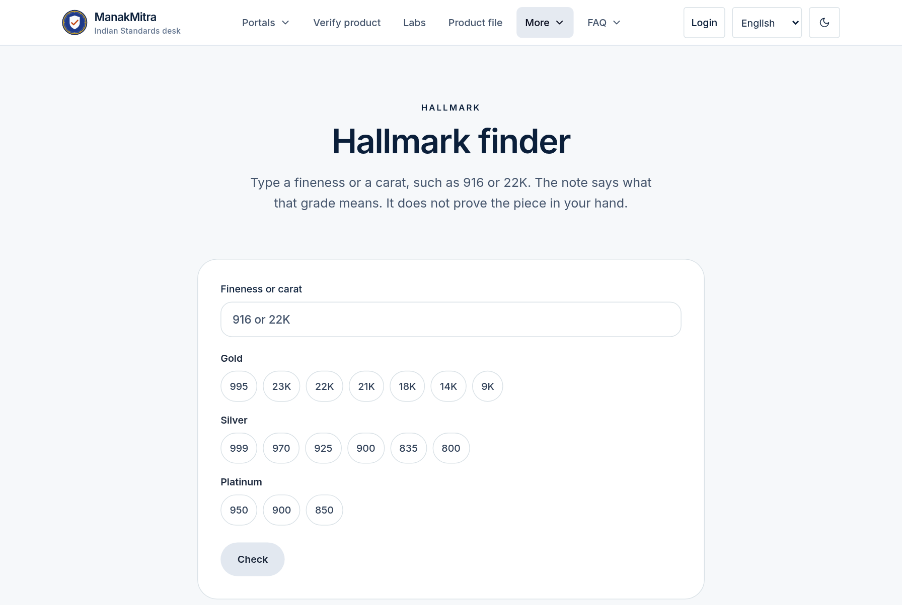 |

**Contents:** [TL;DR](#tldr--what-a-judge-can-verify-today) · [Problem](#1-problem--who-pays-for-the-wrong-door) · [Innovation](#2-innovation--why-a-chatbot-was-not-enough) · [Why this design](#why-this-design-wins) · [Complexity](#3-technical-complexity--what-is-actually-hard) · [Feasibility](#4-feasibility--it-already-runs) · [Evaluation](#experimental-evaluation--benchmark) · [Corpus](#authorised-pack--what-is-actually-in-the-file) · [Business use cases](#business-use-cases) · [Architecture](#5-architecture--system-design) · [Hybrid math](#hybrid-retrieval--the-actual-math) · [Technical internals](#technical-internals) · [Hardening](#operational-hardening) · [Anti-hallucination](#anti-hallucination--stronger-than-a-whitelist) · [Implementation](#6-implementation-quality) · [UX](#7-user-experience) · [Impact](#8-impact) · [Scale](#9-scalability--deployment) · [Start](#quick-start) · [Judge path](#judge-path--no-gpu-no-5-gb-download) · [Team](#team-prograckers)

---

## TL;DR — what a judge can verify today

A pure retrieval demo that always returns top-5 from one PDF is not this product. ManakMitra routes a user to the right BIS door, or refuses when the pack has no verified row.

| Check | What is true | How to see it |
| --- | --- | --- |
| Live multi-desk product | Home, chat, verify, labs, HUID, standards, certify, complaint, contact | [Open the site](https://forest-yonder-apex-plum.vercel.app/) |
| Three exits | Allow (sourced row) · Clarify (one missing fact) · Refuse (portal handoff, retrieval = 0) | Demo video + chat: IS 14543, unclear helmet, fan + HUID |
| Golden gates | M1–M10 pass without an LLM | [Evaluation table](#experimental-evaluation--benchmark) · `npm run eval:all` |
| Hybrid stress | 100 / 100 fail = 0 on the hybrid retrieve path (2026-10-13) | `scripts/hybrid-stress-100.mjs` |
| Pack file | 18,995 catalogue rows + 627 curated chunks, 100% official hosts | [`src/data/rag-pack.json`](src/data/rag-pack.json) |
| Voice + label OCR | Browser STT and Tesseract label read. No invented number. Label-photo path is not end-to-end tested yet | Chat mic is in the live app. Photo path is code only |
| No invented IS / fee / clause | Faithfulness is a pass/fail gate, not a published 0.95 score | M3 and M10 |
| Official host only | A non-allowlisted URL is dropped | `src/lib/official-hosts.ts` |
| Pack-only kill switch | `HYBRID_RAG=0` still returns IS + scheme + official URL | Environment table below |
| No GPU required | Judge laptop runs the pack path in Docker or `npm run dev` | [Judge path](#judge-path--no-gpu-no-5-gb-download) |

What this README will **not** claim: Hit@3 on a 10-query cement set, a 0.45 s GPU latency, or a 559-standard building-materials corpus. Those numbers belong to a different hackathon and a different product. Ours is the SIH26107 assistant: standards **and** schemes **and** process **and** hallmarking **and** labs **and** consumer handoff, with a refuse when evidence is missing.

---

## How this maps to evaluation

Judges score understanding, novelty, depth, feasibility, design, a working build, UX, impact and scale. This README answers those questions with the live product — not a claim sheet.

| Criterion | What to inspect here | Live proof |
| --- | --- | --- |
| Problem understanding | [1](#1-problem--who-pays-for-the-wrong-door) | Wrong-door examples in the [demo video](https://www.youtube.com/watch?v=oi7lZYGw1Uw) |
| Innovation | [2](#2-innovation--why-a-chatbot-was-not-enough) | Fan + HUID **refuse** (retrieval = 0) |
| Technical complexity | [3](#3-technical-complexity--what-is-actually-hard) | Four locks before search; RRF only after unlock |
| Feasibility | [4](#4-feasibility--it-already-runs) | [Live MVP](https://forest-yonder-apex-plum.vercel.app/) |
| Evaluation | [Benchmark](#experimental-evaluation--benchmark) | M1–M10, pack file, live chat |
| Architecture | [5](#5-architecture--system-design) | [RRF note](docs/rrf-and-gate.md) |
| Implementation | [6](#6-implementation-quality) | Desks + `npm run eval:all` |
| UX / UI | [7](#7-user-experience) | First-run path under 30 seconds |
| Impact | [8](#8-impact) | Official BIS scale, not invented MAU |
| Scalability | [9](#9-scalability--deployment) | Pack-only → hybrid extras → Vercel |

---

## 1. Problem — who pays for the wrong door

**Why does this problem exist?**  
BIS already publishes standards and runs certification, hallmarking, laboratory recognition, Standards Clubs, training and consumer affairs. The record is public. The path is not. A manufacturer, jeweller, student or consumer still has to guess which portal, which scheme and which document applies.

**Who faces it?**

| User | What they need | What goes wrong today |
| --- | --- | --- |
| MSME / startup | Applicable IS + scheme before they apply | Consultant fees, or days on the wrong form |
| Manufacturer / importer | ISI vs CRS vs FMCS vs QCO | One product family, several legal doors |
| Jeweller / consumer | Hallmark / HUID check | HUID language applied to fans, helmets, appliances |
| QC / lab user | Recognised lab + LIMS scope | Directory hunting; no PIN-to-lab path |
| Student / Standards Club | Plain-language IS identity | Catalogue and paid text mixed together |
| BIS / DoCA helpdesk | First-level routing | Repeat “which portal?” calls |

**How serious is it?**  
Official published scale of the BIS space (not ManakMitra usage):

| Published stock | Order of magnitude | Source class |
| --- | --- | --- |
| Indian Standards in force | ~23,300 | BIS public reporting cited on the idea PPT |
| Operative licences | ~51,500 | Same |
| New licences in a recent year | ~9,700 | Same |

Searching many portals and PDFs is exactly the pain SIH26107 names. The gap is not “there is no chatbot”. The gap is **routing with evidence**, so a user does not lose days at the wrong BIS door.

A product that only maps a building-material description to a 2005 summary PDF solves one slice of that pain. SIH26107 asks for the rest: certification schemes, process, consumer queries, hallmarking, testing laboratories, and multilingual interaction.

---

## 2. Innovation — why a chatbot was not enough

Generic RAG on mixed PDFs looks complete and still sends a fan query to jewellery verification. ManakMitra treats **refusal as a feature**.

What is unique (not a bundle of existing tools):

1. **Lock-first, retrieve-second.** Search is illegal until scope, scheme, source and evidence unlock.
2. **Scheme router.** ISI, CRS, FMCS, QCO and HUID stay separate. A mismatch does not retrieve.
3. **Three exits.** Allow (sourced row) · Clarify (one missing fact) · Refuse (portal handoff, retrieval = 0).
4. **Hybrid retrieve only after unlock.** Sparse TF-IDF on the pack, then optional Okapi BM25 + `pg_trgm` + pgvector, then RRF.
5. **Model-down continuity.** If the LLM is offline, the pack still returns IS number, scheme path and official URL.
6. **Public metadata only.** No paid clause text, no invented fees, no fake confidence score.
7. **OCR / vision input.** A product-label photo is read in the browser with Tesseract ([`src/lib/label-ocr.ts`](src/lib/label-ocr.ts)). A licence or IS number is kept only if the recognised text contains one. The reader does not invent a number. The label-photo path is implemented, not yet tested end to end.
8. **Voice (STT).** The chat box uses the browser Speech Recognition API. The spoken language follows the header lock (English, Hindi, or Hinglish), not a guess from the audio.
9. **Adversarial suite.** `npm run eval:adversarial` runs 102 injection, fake-IS, Hinglish, scheme-mix, and off-topic queries with no model call. Invented IS count is 0.
10. **Slot memory, no IS carry.** A follow-up may keep the product, the scheme, and a PIN. It never copies an earlier IS number. A new product question drops the old IS (M11).
11. **24-hour feedback.** Useful, Not useful, and Report wrong answer do not download a file. The click POSTs to `/api/feedback`. The server keeps a short row: kind, the question (500 characters), lock steps (8), official evidence links (6), exit note, and language. The model essay is not stored. The preferred table is `public.answer_feedback` ([`migrations/0003_answer_feedback.sql`](migrations/0003_answer_feedback.sql)), with `expires_at` at 24 hours, forced RLS, no anon policy, and no anon grant. Each save deletes expired rows. If that table is not created yet, the same packet is written to `query_logs` with intent `mmfb:` and those rows are deleted after 24 hours. The service role is the only writer. A click is not a BIS complaint and there is no ticket number.
12. **Freshness badge.** Every answer shows `Pack verified:` plus the `verifiedAt` stamp from the pack, and a line that QCO status is not in the pack.
13. **Label to CARE.** A `CM/L-` or `R-` token read from a photo is shown as extracted, not verified, with the BIS complaint page and complaints@bis.gov.in.
14. **Hindi nudge.** Header English plus Devanagari text shows “हिंदी में जवाब चाहिए?”. The tap switches the header lock. The lock does not auto-switch.
15. **WhatsApp desk.** Meta calls `GET/POST /webhook`. The handshake answers with `hub.challenge` when the verify token matches `WHATSAPP_VERIFY_TOKEN`, or the token already issued for this callback if that variable is empty on the host. A text message uses the same `/api/chat` gate. The reply is the spoken answer plus one official link. Photos are sent to the website. No invented IS number. The send token stays in `WHATSAPP_TOKEN` (optional `WHATSAPP_APP_SECRET`). Callback: `https://forest-yonder-apex-plum.vercel.app/webhook`.

This README does not claim a 5 second latency SLA, an India-region deployment, or an admin analytics dashboard.

**Why this was not already solved:** BIS.gov.in is a library of portals, not a gate. A generic assistant can quote a paragraph and still pick the wrong scheme. The hard product is the gate.

---

## Why this design wins

Compared with a local BM25 + dense + cross-encoder stack over one PDF, these choices match the SIH26107 product, not a retrieval leaderboard.

| Decision | Why this, not the alternative |
| --- | --- |
| **Lock-first gate** | A fan + HUID query must not become a jewellery flow. Retrieval = 0 is the correct answer. |
| **Local TF-IDF as the rank lock** | Answers without a GPU, without a 5 GB model download, and without a vendor. Freeze at ≥ 0.45 so a near neighbour cannot replace an exact IS row. |
| **Official-host filter** | A row is usable only if its URL is on `bis.gov.in`, `manakonline.in`, `crsbis.in`, or an allowlisted host. A local whitelist of PDF titles is not the same guarantee. |
| **Refuse when the pack is silent** | Always returning top-5 invents confidence. Clarify or Refuse is the honest exit. |
| **Hybrid extras only when the lock is weak** | Dense, BM25, trigram, and rerank are skipped on a strong lock, a policy pin, and a typed IS already on top. |
| **RRF k = 60, rank only** | Sparse and dense stay on their own scales. Raw cosine is not added to raw BM25. |
| **Gated rerank** | Feature-rerank (or Cohere `rerank-v3.5` if a key is set) runs only when the local top is below 0.45. Frozen hits do not move. |
| **LLM phrases, never sources** | The model may phrase a pack row. It may not invent an IS number, a fee, or a clause. |
| **No paid IS text** | Full document text stays on Know Your Standard and e-Sale. The pack stores public metadata. |
| **Serverless, no GPU** | A judge opens the live site. A laptop runs the pack path with `npm run dev` or Docker. |

---

## 3. Technical complexity — what is actually hard

Complexity is used where the problem needs it.

| Hard part | Why it is not a wrapper |
| --- | --- |
| Policy gate before any index call | Off-topic, clause-ask, and scheme mix-up must die in milliseconds |
| Scheme-conflict detection | “Fan pe HUID” must not become a jewellery flow |
| Sparse + dense + RRF on one authorised pack | Rank fusion only on the unfrozen tail of allowlisted rows |
| Ground-then-generate | The model may phrase a pack row. It may not invent an IS number |
| Standalone turns | Chat history must not leak yesterday’s IS into today’s product |
| Language lock | Header language (EN / HI / Hinglish) beats query-script guessing |
| Eval harness M1–M10 | Gates are tested without an LLM |
| Lab-city word boundary | A contact-person first name must not match a city |

Not used: a billion-vector demo index, synthetic “official” PDFs, or a 22-language claim the pack cannot ground.

---

## 4. Feasibility — it already runs

The MVP is public. A judge can open it without installing anything.

| Proof | Where |
| --- | --- |
| Working app | https://forest-yonder-apex-plum.vercel.app/ |
| Demo walkthrough | https://www.youtube.com/watch?v=oi7lZYGw1Uw |
| Pack-only laptop path | `docker compose up --build` → http://localhost:8080 |
| Eval without an LLM | `npm run eval:all` |
| Hybrid retrieve stress | 100 questions, 0 fail (2026-10-13) |

Business path the product already supports:

| Actor | First action on ManakMitra | Official door it hands off to |
| --- | --- | --- |
| MSME with a product | Ask which IS and which scheme | Manakonline / CRS / Know Your Standard |
| Jeweller | Ask HUID format and verify path | huid.manakonline.in |
| Consumer with a fake mark | File a complaint | CARE / CMED |
| Lab user | Enter a PIN | LIMS directory |
| Student | Ask what an IS number is | Catalogue row + official URL |

Roadmap after the MVP (from the idea PPT, not vapour):

1. Scheme-conflict graph
2. Evidence freshness leases
3. Adversarial safety harness
4. Officer escalation packets
5. Gap scanner as a pathway constraint engine

Mature pieces: Postgres FTS + pgvector, serverless Node, optional LLM phrasing. The pack path does not depend on a model vendor.

---

## Experimental evaluation & benchmark

These tables are from this repository and the live deployment. They are not copied from another product's fine-tune sheet. We do not publish Recall@1 / NDCG on a private 100-question set we have not released. A reader can open the pack file and re-run the gates.

### Golden gates — `npm run eval:metrics` (2026-10-18)

No LLM is called. A gate fails the build if it misses its threshold.

| Evaluation metric | Pass | Total | Result | Threshold | What it locks |
| --- | ---: | ---: | ---: | ---: | --- |
| M1 Family pin | 56 | 56 | 100% | 100% | Product family stays on its own IS |
| M2 Retrieval@3 | 55 | 55 | 100% | 95% | Expected row is in the top 3 |
| M3 Hallucination-0 | 12 | 12 | 100% | 100% | No invented IS, fee, or clause |
| M4 Official URL 100% | 7 | 7 | 100% | 100% | Every usable row has an allowlisted host |
| M5 Clarify-first | 5 | 5 | 100% | 100% | One missing fact asks one question |
| M6 Scheme mix-up 0 | 4 | 4 | 100% | 100% | Fan + HUID does not become jewellery |
| M7 Off-topic reject | 6 | 6 | 100% | 100% | Cake, cricket, tickets refuse before search |
| M8 Standalone query | 3 | 3 | 100% | 100% | Yesterday's IS does not leak into today |
| M9 Multilingual lock | 12 | 12 | 100% | 100% | Header language beats script guessing |
| M10 Clause honesty | 1 | 1 | 100% | 100% | Paid clause text is not quoted |
| **M1–M10** | **161** | **161** | **100%** | — | **Failed gates: 0** |

Reproduce: `npm run eval:metrics`. The harness is [`scripts/eval-metrics.mjs`](scripts/eval-metrics.mjs).

### Hybrid retrieve stress — 100 questions (2026-10-13)

Weak-lock path only. Strong locks still freeze. No web.

| Bucket | Questions | Fail | Mean ms |
| --- | ---: | ---: | ---: |
| Product | 40 | 0 | 655 |
| Process | 15 | 0 | 181 |
| Lab | 12 | 0 | 1,329 |
| Typed IS | 10 | 0 | 98 |
| Hindi | 8 | 0 | 112 |
| Weak lock | 8 | 0 | 73 |
| Edge | 7 | 0 | 1,851 |
| **All** | **100** | **0** | p95 **29 ms** (local rank) |

Source: [`artifacts/hybrid-stress-100.json`](artifacts/hybrid-stress-100.json). Script: [`scripts/hybrid-stress-100.mjs`](scripts/hybrid-stress-100.mjs).

### Three-million lock stress — exit verdicts, not a leaderboard

Combinatorial questions across TF-IDF, hybrid, and generic phrasing. Each file has 1,000,000 rows. This is a lock/exit stress, not an expert IR benchmark. **Mixed** means the stored scorer and the expected exit disagreed. It is not a counted invented IS.

| Lane | Rows | Correct exit | Mixed | Hallucinated IS / fee |
| --- | ---: | ---: | ---: | ---: |
| TF-IDF (`HYBRID_RAG=0`) | 1,000,000 | 922,789 | 77,211 | 0 |
| Hybrid extras after a weak lock | 1,000,000 | 997,265 | 2,735 | 0 |
| Generic product path | 1,000,000 | 952,230 | 47,770 | 0 |
| **Total** | **3,000,000** | **2,872,284** | **127,716** | **0** |

The generic mixed rows were concentrated in the first 573,000, before the 2026-10-17 scorer reload (city-only lab list, and a scheme question treated as a hallmark mix). Rows scored after that reload had 0 mixed. The stored CSV was not rewritten. Off-topic and real scheme-mix still refuse.

The **0** in the last column is invented IS or fee only. Lab ranking is a separate desk. A PIN or device location is placed on a city-centre point. The card keeps three sources apart: **BIS laboratory** (BIS own), **BIS recognised** (Group-1 extract), and **national laboratory** (NPL and the other public laboratories). A national laboratory is not a BIS laboratory and not a recommendation. The map is a Google embed of those coordinates, not a surveyed gate. A product name does not mean the laboratory is accredited for that IS.

Hallmark PIN search uses the 10 Oct 2026 cancelled and suspended centre extract only. Those rows are marked not open. HUID on this desk is a 6-character shape check, not the live BIS CARE register. Verify, product file, and standards read the local pack before any database call.

### Live deployment — checked 2026-10-30

| Check | Result | Where |
| --- | --- | --- |
| Home | 200 | [forest-yonder-apex-plum.vercel.app](https://forest-yonder-apex-plum.vercel.app/) |
| Health | 200, `{"ok":true,"pack":false}` | `/api/health` |
| Contact | 200, published BIS lines | `/contact` |
| Sourced product | Allow — **IS 14543** for PET bottles | `/chat` |
| Scheme refuse | Fan + HUID refuses (retrieval = 0) | `/chat` |
| Production commit | `27a54fa` | Vercel project `forest-yonder-apex-plum` |

---

## Authorised pack — exact volume, not just rows

Two layers. Do not add them together.

| Layer | What it is | What it is not |
| --- | --- | --- |
| **Runtime pack** | [`src/data/rag-pack.json`](src/data/rag-pack.json). This is what chat, verify, labs and certify search. | Not the 40k corpus extract |
| **Source files** | Numbered CSVs and the knowledge JSON under [`data/`](data/). They feed a rebuild. | Not a second live index |

Counts and sizes below were read from the files on 2026-10-18. A reader can re-count with the snippet at the end of this section.

### How much text the live pack actually holds

A row count hides this. These are the characters and words inside the 19,622 evidence rows.

| Measure | Catalogue (18,995) | Chunks (627) | All evidence rows (19,622) |
| --- | ---: | ---: | ---: |
| Body characters | 4,112,459 | 156,577 | **4,269,036** |
| Body words | 359,025 | 23,484 | **382,509** |
| Title characters | 384,341 | 22,449 | **406,790** |
| Title words | 105,121 | 3,227 | **108,348** |
| URL characters | 1,978,869 | 40,071 | **2,018,940** |
| ID characters | 254,820 | 5,828 | **260,648** |
| Unique IDs | 18,995 | 627 | **19,622** |
| Unique titles | 18,995 | 587 | **19,582** |
| Unique URLs | 17,393 | 27 | **17,419** |
| Shortest body | 34 chars | 73 chars | 34 chars |
| Longest body | 489 chars | 862 chars | 862 chars |
| Mean body | 216.5 chars | 249.7 chars | 217.6 chars |

The live file on disk is **10,367,778 bytes** (9.89 MB). That includes the 7,765-term vocab and IDF tables, not only the row text.

Text the model is allowed to phrase: the body + title above. About **4.68 million characters** and **490,857 words**. No paid clause text is in that total.

### Body volume by chunk kind

| Kind | Rows | Body characters | Body words | Mean body |
| --- | ---: | ---: | ---: | ---: |
| lab | 437 | 110,248 | 17,181 | 252 chars |
| crs | 110 | 24,591 | 3,094 | 224 chars |
| faq | 28 | 8,123 | 1,228 | 290 chars |
| process | 19 | 5,635 | 849 | 297 chars |
| hallmark | 6 | 3,215 | 477 | 536 chars |
| consumer | 10 | 1,705 | 231 | 171 chars |
| product | 4 | 1,623 | 224 | 406 chars |
| link | 13 | 1,437 | 200 | 111 chars |
| **chunks** | **627** | **156,577** | **23,484** | **250 chars** |

### File sizes on disk

| File | Bytes | What the bytes are |
| --- | ---: | --- |
| [`src/data/rag-pack.json`](src/data/rag-pack.json) | **10,367,778** | Live retrieve file. 19,622 rows + vocab |
| [`src/data/bis-index.json`](src/data/bis-index.json) | 7,212,284 | Pack-input mirror. Not a second chat index |
| [`data/manakmitra_bis_knowledge.json`](data/manakmitra_bis_knowledge.json) | 7,779,781 | Authorised metadata JSON, collected 2026-09-08 |
| [`data/bis_chatbot_knowledge_base.json`](data/bis_chatbot_knowledge_base.json) | 675,817 | Early 2,291-standard notes. Not the live pack |
| [`data/01_standards.csv`](data/01_standards.csv) … [`10_documents_metadata.csv`](data/10_documents_metadata.csv) | 1,147,024 | Ten source CSVs together |
| [`data/recognised-laboratories.json`](data/recognised-laboratories.json) | 167,624 | 430-lab source list |
| [`src/data/inbox-boost.json`](src/data/inbox-boost.json) | 87,054 | 125 inbox pins |
| [`data/inbox/bis-20261010-narratives.json`](data/inbox/bis-20261010-narratives.json) | 43,059 | 99 narratives, not auto-merged |
| [`data/product-manuals-manifest.json`](data/product-manuals-manifest.json) | 29,695 | 108 files / 1,104 candidate rows, quarantined |
| [`src/data/verified-boost.json`](src/data/verified-boost.json) | 27,424 | 44 pin rows |
| [`data/bis-corpus.sqlite`](data/bis-corpus.sqlite) | **61,853,696** | Extract store, 41,777 docs. Chat does not search this |
| **Listed files** | **89,396,147** | About 85.2 MB. Do not treat the SQLite as live RAG |

### Runtime pack identity

| Field | Exact value | Source |
| --- | ---: | --- |
| File | [`src/data/rag-pack.json`](https://github.com/owais265/ManakMitra/blob/main/src/data/rag-pack.json) | git path |
| Raw download | [raw file](https://raw.githubusercontent.com/owais265/ManakMitra/main/src/data/rag-pack.json) | GitHub raw |
| Bytes | 10,367,778 | `wc -c` |
| Blob SHA | `309809b959dc0ad09f9bbf2ee6cce81d83036a06` | `git rev-parse HEAD:src/data/rag-pack.json` |
| SHA-256 | `109a028c999ca8a3d018574bedf744a2b0a8d1602627cc045406db94d4e799a8` | `sha256sum` |
| Verified stamp | 2026-09-13 | `verified` / `verifiedAt` inside the file |
| Last pack commit | `f5b6ab9`, 2026-10-11 | git log |
| Catalogue standards | **18,995** | `catalogue` array |
| Curated chunks | **627** | `chunks` array |
| Evidence rows searched | **19,622** | catalogue + chunks |
| TF-IDF docs | 627 | `docs` array (chunk index) |
| Vocab terms | 7,765 | `vocab` |
| IDF entries | 7,765 | `idf` |
| Empty bodies | 0 | every row has `body` |
| Missing URLs | 0 | every row has `url` |
| Official-host URLs | 19,622 / 19,622 | allowlisted BIS hosts only |
| Titles with a trailing year | 18,044 | catalogue titles ending `: YYYY` |
| Titles with no trailing year | 951 | of 18,995 |
| Year span on dated titles | 1949–2026 | 75 distinct years |
| Paid clause text stored | 0 | metadata only |

### Catalogue and chunk kinds

| Kind | Rows | Cite |
| --- | ---: | --- |
| standard (catalogue) | 18,995 | `catalogue[].kind` |
| lab | 437 | `chunks[].kind` |
| crs | 110 | `chunks[].kind` |
| faq | 28 | `chunks[].kind` |
| process | 19 | `chunks[].kind` |
| link | 13 | `chunks[].kind` |
| consumer | 10 | `chunks[].kind` |
| hallmark | 6 | `chunks[].kind` |
| product | 4 | `chunks[].kind` |
| **chunks subtotal** | **627** | |
| **all evidence rows** | **19,622** | |

### Scheme tags on those 19,622 rows

| Scheme tag | Rows |
| --- | ---: |
| published | 17,873 |
| isi | 877 |
| lab | 429 |
| crs | 304 |
| hallmark | 85 |
| faq | 19 |
| process | 15 |
| link | 10 |
| consumer | 9 |
| product | 1 |
| **total** | **19,622** |

### Official hosts on those 19,622 URLs

| Host | Rows | What it is |
| --- | ---: | --- |
| www.services.bis.gov.in | 17,399 | Know Your Standard |
| standards.bis.gov.in | 1,599 | Standards portal |
| www.bis.gov.in | 495 | BIS site, FAQ, consumer |
| www.crsbis.in | 121 | CRS |
| lims.bis.gov.in | 5 | Laboratory directory |
| standardsbis.bsbedge.com | 1 | e-Sale host |
| www.manakonline.in | 1 | Apply |
| huid.manakonline.in | 1 | HUID verify |
| **total** | **19,622** | |

### Product families

| Item | Exact value | Source |
| --- | ---: | --- |
| Named families in the playbook | 59 | [`src/lib/product-playbook.ts`](src/lib/product-playbook.ts) |
| Distinct `family` tags on pack rows | 39 | pack `family` field, excluding `-` |
| Pack rows with a family tag | 115 | of 19,622 |
| Pack rows with no family tag | 19,507 | catalogue titles still retrieve by IS / text |

### Source files that feed a rebuild

These are the human-editable inputs. They are smaller than the runtime catalogue. [`data/README.md`](data/README.md).

| File | Rows | Bytes | Columns start with | Cite |
| --- | ---: | ---: | --- | --- |
| [`data/01_standards.csv`](data/01_standards.csv) | 2,291 | 943,939 | standard_id, title | curated standards list |
| [`data/02_product_requirements.csv`](data/02_product_requirements.csv) | 4 | 3,709 | product_name | product → IS |
| [`data/03_certification_process.csv`](data/03_certification_process.csv) | 14 | 9,568 | scheme_name, step_number | process steps |
| [`data/04_testing_labs.csv`](data/04_testing_labs.csv) | 433 | 160,759 | lab_name, city | lab directory |
| [`data/05_hallmarking.csv`](data/05_hallmarking.csv) | 6 | 4,753 | metal, fineness_code | hallmark grades |
| [`data/06_crs_products.csv`](data/06_crs_products.csv) | 2 | 1,730 | product_name | CRS seed |
| [`data/07_consumer_support.csv`](data/07_consumer_support.csv) | 10 | 5,146 | topic | consumer desk |
| [`data/08_faqs.csv`](data/08_faqs.csv) | 11 | 7,034 | question | FAQ |
| [`data/09_official_links.csv`](data/09_official_links.csv) | 13 | 5,626 | official_url | portal links |
| [`data/10_documents_metadata.csv`](data/10_documents_metadata.csv) | 10 | 4,760 | document_title | document cards |
| **CSV total** | **2,794** | **1,147,024** | | not the live index |

### Authorised metadata JSON

[`data/manakmitra_bis_knowledge.json`](data/manakmitra_bis_knowledge.json). Collected 2026-09-08. File note: metadata only, full IS/ISO PDF clauses are not stored. Its own `meta.counts`:

| Record | Exact value |
| --- | ---: |
| standards | 17,393 |
| crs_products | 72 |
| explore_bis | 7 |
| crs_scheme | 5 |
| iso_iec_intro | 3 |
| iso_iec_catalogue_hits | 2,299 |
| total_records (file's own sum) | 19,779 |
| File bytes | 7,779,781 |

The 18,995 catalogue rows in the runtime pack are this standards list plus later catalogue-linked rows. The 2,299 ISO/IEC hits are catalogue links, not extra overlapping retrieve rows. Eval ingestion reports the same 2,299.

### Other on-disk data — not the live rank

These exist in the repo. Chat does not search them as a second index.

| File | Exact value | Note |
| --- | ---: | --- |
| [`src/data/bis-index.json`](src/data/bis-index.json) | standards 18,995 · labs 433 · process 14 · crs 120 · faqs 11 · links 13 · consumer 10 · hallmark 6 · products 4 | mirror of the pack inputs. Verified 2026-09-08. 7,212,284 bytes |
| [`src/data/verified-boost.json`](src/data/verified-boost.json) | 44 rows | pin boost. Eval reports boost 44 |
| [`src/data/inbox-boost.json`](src/data/inbox-boost.json) | 125 rows | inbox pins |
| [`src/data/pack-meta.json`](src/data/pack-meta.json) | chunks 627, catalogue 18,995, boost 24 | stamp 2026-09-13 |
| [`data/recognised-laboratories.json`](data/recognised-laboratories.json) | 430 labs | source list. Pack uses 437 lab chunks |
| [`data/inbox/bis-20261010-narratives.json`](data/inbox/bis-20261010-narratives.json) | 99 narratives | not auto-merged to main pack |
| [`data/product-manuals-manifest.json`](data/product-manuals-manifest.json) | 108 files, 1,104 candidate rows | quarantined on edition mismatch. Not in the live pack |
| [`data/bis-corpus.sqlite`](data/bis-corpus.sqlite) `docs` | 41,777 rows | extract store. Not the chat index |
| Corpus manifest `docs` | 40,731 | [`data/bis-corpus-manifest.json`](data/bis-corpus-manifest.json), 239 files seen |

Corpus manifest `by_kind` (extract, not live retrieve): standard 25,526 · process 5,807 · hallmark 3,457 · crs 3,219 · product 1,913 · lab 729 · consumer 80.

### Dense extra on Supabase `pack_docs`

Optional. A strong local lock does not call it. Counted 2026-10-18 via `Prefer: count=exact`.

| State | Rows |
| --- | ---: |
| Embedding present (768-d) | 35,678 |
| Embedding null | 26,624 |
| Total `pack_docs` | 62,302 |

### Re-count the runtime pack

```bash
python3 -c "
import json
from collections import Counter
from urllib.parse import urlparse
d=json.load(open('src/data/rag-pack.json'))
rows=d['chunks']+d['catalogue']
print('catalogue', len(d['catalogue']), 'chunks', len(d['chunks']), 'rows', len(rows))
print('kinds', Counter(c['kind'] for c in d['chunks']))
print('schemes', Counter(r.get('scheme') or '-' for r in rows))
print('hosts', Counter(urlparse(r['url']).netloc for r in rows))
print('body_chars', sum(len(r.get('body') or '') for r in rows))
print('body_words', sum(len((r.get('body') or '').split()) for r in rows))
print('title_chars', sum(len(r.get('title') or '') for r in rows))
print('unique_url', len({r['url'] for r in rows}))
"
```

---


## Business use cases

These are first-level paths the product already supports. Each ends at an official BIS door. None invents a fee, a licence status, or a clause.

### UC1 — MSME, bottled water, wrong scheme avoided

An MSME makes PET bottles for drinking water. Today they search three portals and may file under the wrong scheme.

| Step | What ManakMitra does |
| --- | --- |
| User asks | “Which Indian Standard applies to PET bottles for drinking water?” |
| Gate | Scope and scheme pass. This is an ISI product question, not HUID. |
| Retrieve | Local TF-IDF lock on the pack. Strong hit freezes. Hybrid extras are not called. |
| Exit | **Allow.** Catalogue title + official URL (Know Your Standard / services.bis.gov.in). |
| Next action | User opens the official record, then Manakonline if they want to apply. |

Business outcome: the first wrong form is not filled. The app does not quote the paid clause text and does not invent the licence fee.

### UC2 — Jeweller, HUID only

A jeweller asks how to check a hallmark. A fan manufacturer must not land on the same desk.

| Step | What ManakMitra does |
| --- | --- |
| User asks | HUID format, or “how do I verify this jewellery hallmark?” |
| Gate | Scheme lock allows HUID only for jewellery. |
| Exit | **Allow** with the official verify path on huid.manakonline.in. |
| Contrast | “Fan pe HUID kaise check karun?” fails the scheme lock. Retrieval = 0. **Refuse** with a portal handoff, not a jewellery result. |

Business outcome: hallmark language stays on jewellery. Appliance queries do not get a false HUID answer.

### UC3 — Consumer, fake mark

A consumer suspects a fake ISI mark on a product.

| Step | What ManakMitra does |
| --- | --- |
| Desk | File a complaint |
| Exit | Handoff to CARE / CMED. No invented ticket number. |
| Contact | Published lines only (complaints@bis.gov.in, 011 2323 5609, Manak Bhavan). |

Business outcome: the complaint reaches the real desk. The app does not pretend to be BIS.

### UC4 — Lab user, PIN to LIMS

A QC engineer needs a recognised lab near a plant.

| Step | What ManakMitra does |
| --- | --- |
| Input | 6-digit PIN on the labs desk. City name is rejected on purpose. |
| Retrieve | Lab rows from the pack. City match uses a word boundary, so a contact-person first name does not count as the city. |
| Exit | Name / address list + live LIMS link. Scope of the lab is confirmed on lims.bis.gov.in, not invented. |

Business outcome: no guessed rating, no booked test. The user lands on the official directory.

### UC5 — Importer, scheme split

An importer asks whether a product is ISI, CRS, or FMCS.

| Step | What ManakMitra does |
| --- | --- |
| Gate | Scheme router keeps ISI, CRS, FMCS, and QCO separate. |
| Exit | **Clarify** if the product family is underspecified (one missing fact). **Allow** only when the pack has the scheme row. |
| Handoff | CRS path goes to crsbis.in. ISI path goes to Manakonline. |

Business outcome: one product family is not filed under two schemes. The app names the door; it does not file the application.

### UC6 — Student / Standards Club

A student asks what an IS number means, or pastes an IS number.

| Step | What ManakMitra does |
| --- | --- |
| Typed IS | If that number is already the top pack title, extras do not run. Neighbours cannot replace it. |
| Unknown IS | Policy pin. No invented title. **Refuse** or **Clarify**, with the official catalogue link. |
| Language | Header lock: English, Hindi, or Hinglish. The lock beats script-guessing. |

Business outcome: plain-language identity of a standard, with the official record, without paid clause text.

### UC7 — BIS / DoCA helpdesk, first-level routing

A helpdesk still answers “which portal?” dozens of times a day.

| Step | What ManakMitra does |
| --- | --- |
| Role | First-level router, not an officer. |
| Output | One of three exits plus the official URL or the right desk. |
| What it will not do | Decide a licence, quote a fee, or escalate a case. |

Business outcome: repeat portal questions drop to a handoff card. The officer still owns the decision.

---

## 5. Architecture and system design

Search is not allowed until the gate unlocks.

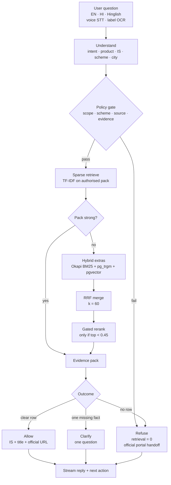

The idea deck draws the hybrid core as PostgreSQL FTS + `pg_trgm` + pgvector HNSW + RRF. In this repo the **always-on sparse rank is local TF-IDF** over the JSON pack. Okapi BM25, `pg_trgm`, and pgvector are optional, and only after that pack is weak.

| Layer | Choice | Why this, not a larger stack |
| --- | --- | --- |
| App | React 19, TanStack Start, Vite, Tailwind | One TypeScript surface for UI + `/api/chat` |
| Gate + sparse RAG | [`src/lib/rag.ts`](src/lib/rag.ts), [`src/data/rag-pack.json`](src/data/rag-pack.json) | Answers without a vendor |
| Hybrid extras | Optional Okapi BM25 + `pg_trgm` + pgvector HNSW, fused by RRF (`k = 60`) | Never the rank lock. [`docs/rrf-and-gate.md`](docs/rrf-and-gate.md) |
| Phrasing LLM | Optional xAI, Gemini fallback | Phrases pack rows. Never the source of an IS number |
| Hosting | Vercel + Supabase | Live MVP for evaluation |

| Lock | Blocks |
| --- | --- |
| Scope | Sports, movies, trivia |
| Scheme | HUID on a fan, CRS language on jewellery |
| Source | Non-allowlisted hosts |
| Evidence | No pack row → no generated “fact” |

---

## Hybrid retrieval — the actual math

Formulas below are what the repository runs. Full write-up: [`docs/mathematical-framework.md`](docs/mathematical-framework.md).

### Policy gate

Four locks, each 0 or 1. Search is allowed only when the product is 1.

```text
Proceed(Q) = 1    iff    L_scope(Q) * L_scheme(Q) * L_source(Q) * L_evidence(Q) = 1
```

There is no soft cutoff. One failed lock stops the path.

### Local TF-IDF lock

Unigrams and bigrams. Sublinear TF. Smoothed IDF. L2-normalised cosine.

```text
tf(t, d)  = 1 + log(count(t, d))     when count > 0, else 0
idf(t)    = log( (1 + |D|) / (1 + df(t)) ) + 1
score     = cosine( normalise(q), normalise(d) )
```

A hit at score ≥ 0.45 is frozen. A typed IS number already on top is also a lock. Neither calls dense, BM25, trigram, or rerank.

### Okapi BM25 extras

Postgres has no BM25. `search_pack_docs_bm25` is Okapi, not `ts_rank`.

```text
idf(t) = ln( 1 + (N - df(t) + 0.5) / (df(t) + 0.5) )
tf_norm = (tf * (k1 + 1)) / (tf + k1 * (1 - b + b * dl / avgdl))
BM25(q, d) = sum over t in q of idf(t) * tf_norm(t, d)
k1 = 1.2
b = 0.75
```

An exact `is_number` hit gets a prior of 1000 inside the BM25 lane only. That prior is not added into the RRF sum. SQL: [`supabase/search_pack_docs_bm25.sql`](supabase/search_pack_docs_bm25.sql).

### Three-lane RRF

Used only after the gate, and only when the local pack row is weak. A missing lane adds 0.

```text
RRF(d) = 1/(60 + rank_dense(d)) + 1/(60 + rank_bm25(d)) + 1/(60 + rank_trgm(d))
```

RRF adds ranks. It does not add raw cosine to raw BM25. Extras are capped at three. An extra row’s displayed score is capped at 0.39 so it cannot sit above a frozen pack row.

### Gated rerank

Rerank runs only when extras exist and the local top is below 0.45, and never on a policy pin. Frozen pack rows are not in the rerank input. A non-official URL is dropped. With no rerank key the order is an explicit feature-rerank (exact IS, title token, BM25 lane, official host, family). That is a tie-break, not a neural score.

---


## Technical internals

### Request lifecycle

One chat turn does not call every index.

```text
1. Language lock (the header language, not the typed script)
2. Per-IP sliding window (20 / min on chat, labs, verify). Over → 429 + Retry-After. No Gemini, no Supabase.
3. Intent: product, typed IS, scheme, city / PIN, process, consumer
4. Policy gate: scope × scheme × source × evidence
5. Fail → Refuse or Clarify. Retrieval calls = 0
6. Pass → identical query + desk in the 60 s cache? Return that. Else local TF-IDF on rag-pack.json
7. Strong lock (score ≥ 0.45) or typed IS on top → freeze. Stop. Cache the row.
8. Weak lock only → hybrid extras (BM25 + trgm + dense) → RRF k=60 → gated rerank
9. Official-host filter. Drop anything else.
10. Ground the reply on the surviving rows. LLM may phrase. It may not source.
11. Output lock. Drop a reply that names an IS or a URL the trusted rows do not support. Send the pack fallback.
12. Shape. One question stays short. Several numbered points each get an answer. A [SOURCE] line only when a row was used.
```

Standalone turns: yesterday’s IS is not injected into today’s product query (M8). Follow-up history is the last 6 turns, 400 characters each. A question is capped at 2,000 characters. A caller can send `x-cache-bust` to skip the 60 s retrieval cache. A refuse caused by a transient database error is not cached. The rate limit uses the platform IP and drops stale buckets.

### Operational hardening

These sit in front of the gate. They do not change lock order.

| Control | What it does | What it is not |
| --- | --- | --- |
| Rate limit | In-process sliding window, 20 requests / 60 s per IP per route on `/api/chat`, `/api/labs`, `/api/verify`. 429 with `Retry-After`. | Not shared across Vercel instances. No Redis. |
| Retrieval cache | 60 s TTL, key = normalised query + desk, capped at 200 keys. Only after the policy gate passes. | Not a model cache. Bypass with `x-cache-bust`. |
| Timeouts + one retry | One retry with jitter on 429, 503, or a fast network abort. A slow timeout is not retried. Total wait stays under the chat budget. | Not an unbounded retry loop. |
| Health | `GET /api/health` → `{ ok: true, pack }`. No Gemini call. Does not 500 if Supabase is slow. | `pack` is a disk check. On Vercel the pack is bundled, so `pack` may be false while answers still come from the bundle. |
| Structured log | One line: request id, desk, lock-or-extras, cache, limited, refuse reason, latency ms. | Query text that looks like a phone or a key is not logged. |
| Idempotent embed writes | `PATCH` only where `embedding IS NULL`, and only a 768-d vector. | A row that already has a vector is not rewritten. |
| Embed key rotation | One Gemini request at a time, round-robin across keys. On Supabase `57014` the fetch retries up to 3 times and the key cursor does not advance. When every key is on a cooldown longer than 10 minutes, the process exits. | Not parallel embedding. |
| CI | Typecheck + Vite build + `eval:metrics`. | Does not run a red `npm test` suite. |
| Migrations | Index SQL goes through `scripts/migrate.mjs`. `npm run build` is Vite only; `npm run build:release` also migrates. | No hand-applied SQL outside that path. |

### Data model — what is stored

Public catalogue metadata only. No paid clause text.

| Kind | What a row holds | What it does not hold |
| --- | --- | --- |
| standard | IS number, title, official URL | Full standard text, clause numbers not on the public page |
| product | Family, scheme, pinned IS when the pack has it | A synthetic SKU or a chat-only-item |
| process | Steps and portal when the FAQ pack has them | Invented fees or statutory timelines |
| lab | Name, address, and city. Three labels stay apart: BIS own laboratory, BIS-recognised Group-1 row, national laboratory such as NPL | A test booking, a rating, or calling NPL a BIS laboratory |
| hallmark | HUID format and jewellery-only verify path | HUID applied to a fan or helmet |
| crs | CRS product map when present | A completed registration |
| faq / consumer | Published contact and complaint path | A ticket number |

Pack snapshot: `src/data/rag-pack.json`. Standards metadata in the extract is id + title (about 2,291 rows in the public extract). Group-1 labs in the extract: about 433. CRS / product maps are incomplete. Fees in the pack are FAQ figures and must be re-checked live.

### Indexing

| Index | Where | When it runs |
| --- | --- | --- |
| TF-IDF | Local JSON pack, unigrams + bigrams, sublinear TF, smoothed IDF, L2 cosine | Every in-scope question |
| Okapi BM25 | Postgres `search_pack_docs_bm25`, GIN on the rarest term + `is_number` btree, `enable_seqscan=off` | Weak lock only. SQL is in the repo; the live function is applied separately. |
| pg_trgm | `search_pack_docs_trgm` | Weak lock, typo lane |
| pgvector HNSW | Gemini `text-embedding-004`, 768-d, same model for query and document | Weak lock, and only if that kind has enough embeddings (standards ≥ 400, labs ≥ 50) |
| Partial index `pack_docs_null_embedding_id` | `(id) WHERE embedding IS NULL` | Embed fetch of unfilled rows. Migration is in the repo; the live Supabase role is read-only, so apply it on a writer connection. |
| Rerank | Feature-rerank by default. Cohere `rerank-v3.5` only if a key is set, 2.5 s timeout | Weak lock, top < 0.45, frozen rows excluded |

Embeddings are partial on purpose. A 1-row vector index is not allowed to nearest-neighbour the answer. Dense is skipped until the lane is filled.

### Scheme router

ISI, CRS, FMCS, QCO, and HUID are separate doors. The router is a lock, not a prompt hint.

| Query shape | Scheme lock | Retrieval |
| --- | --- | --- |
| Product + ISI language | ISI | Pack, then extras if weak |
| Electronics registration language | CRS | CRS rows only |
| Jewellery + hallmark | HUID | Hallmark path only |
| Fan / helmet + HUID | Fail | Retrieval = 0 |
| Underspecified product | Clarify | One missing fact, no guess |

### What the LLM is allowed to do

| Allowed | Not allowed |
| --- | --- |
| Phrase a pack row in EN / HI / Hinglish | Invent an IS number |
| Point at the official URL already in the row | Invent a fee or a timeline |
| Ask one clarifying question | Quote a clause that is not in the pack |
| Stay silent when the pack is empty | Fill a licence form or book a lab |

Kill switch: `HYBRID_RAG=0` skips BM25, trigram, pgvector, and rerank. The pack still returns the IS number, the scheme path, and the official URL.

---

## Anti-hallucination — stronger than a whitelist

A whitelist extracted from one PDF guarantees the code exists in that PDF. It does not guarantee the code is the right door, the current title, or an official host.

ManakMitra stacks these refusals:

| Guard | What it stops |
| --- | --- |
| Official-host filter | Any URL not on `bis.gov.in`, `manakonline.in`, `crsbis.in`, or an allowlisted host |
| Evidence lock | No pack row → no generated fact. Exit is Refuse or Clarify |
| Faithfulness M3 / M10 | An IS number or clause that is not in the retrieved rows |
| Policy pin | Scheme mix-up, unknown IS, fake portal — extras are not called |
| Typed-IS freeze | A user-typed IS already on top cannot be replaced by a neighbour |
| Output lock | An IS number in the model reply must already be in the trusted pack or desk rows. A URL must be an official host or already on those rows. Otherwise the pack fallback is sent. |

The system can still be wrong when the pack is stale. It cannot invent an IS that is not in the retrieved rows, and it will not answer a scheme mix-up with a retrieved neighbour.

---

## 6. Implementation quality

Built desks, not a slide-only assistant.

| Desk | User job |
| --- | --- |
| Assistant | Natural-language Q&A with three exits |
| Verify product | Licence-shaped check against the verify pack |
| Testing labs | PIN or device location. BIS own laboratories keep a slot. Group-1 rows are BIS recognised. NPL is listed as a national laboratory, not as BIS |
| HUID / Hallmark finder | Jewellery path only |
| Indian Standards finder | Product / IS → catalogue row |
| Certification steps | Scheme process + official portal |
| File a complaint | CARE / CMED handoff |

Measured latency (prototype, idea PPT):

| Path | Measured / target | Notes |
| --- | --- | --- |
| Off-topic refuse | ~0.1–0.2 s | Gate only. Retrieval not called. [Trace](docs/rrf-and-gate.md) |
| In-scope pack answer | ~1.0–1.8 s | Gate + retrieve + pack |
| LLM phrasing | ~3–6 s | Only when a key works |
| Policy gate | < 50 ms | Four locks |
| Sparse / dense / RRF | < 200 / 300 / 100 ms | After unlock |

Out-of-scope path shape (band from the idea deck, not a fresh production stopwatch):

```text
query            "who won the cricket match yesterday"
lock.scope       FAIL
lock.scheme      skip
lock.source      skip
lock.evidence    skip
retrieval_calls  0
exit             REFUSE
time_band        0.1–0.2 s
```

Safety eval (`npm run eval:all`, no LLM required):

| Id | Gate |
| --- | --- |
| M1 | Product-family pin |
| M2 | Retrieval@3 of the pinned IS / CRS row |
| M3 | No invented IS; off-topic does not retrieve |
| M4 | Official URL present |
| M5 | Clarify-first on an underspecified product |
| M6 | Scheme mix-up blocked |
| M7 | Off-topic reject |
| M8 | Standalone query (no leaked IS) |
| M9 | Multilingual lock |
| M10 | Clause honesty |

---

## 7. User experience

A first-time user should not need a manual. Screenshots from the live site are in [Live product](#live-product--screenshots-from-vercel-2026-10-30).

- One header language lock across every desk. Twelve reply languages. Each script has a webfont, so Bengali, Tamil, Telugu, Gujarati, Kannada, Malayalam, Gurmukhi, Odia, and Urdu draw, not only English and Devanagari.
- Under a finished answer: copy, useful, not useful, report, and read-aloud. Read-aloud uses the browser voice for the selected language and marks the word being spoken. A greeting does not get a source card.
- The opening film runs behind the header, the headline, and the assistant device, and stops above the real-screens desk. The home header has no solid bar, so the film and the side cards show through. Both themes use a short local clip with a still poster. Only the visible film downloads.
- Suggested prompts on the landing page, same queries the assistant accepts
- Status the user can read: sourced answer, one clarifying question, or official handoff
- Official URL on an Allow — not a screenshot of a PDF
- Contact / complaint scrolls to the real handoff, it does not invent a ticket
- Light and dark theme; mobile, tablet and laptop
- Login sits between FAQ and the language control. Google and X use this app's own account system. Email is the same screen for log in or sign up. A guest in the assistant can ask 20 questions; only that guest locks, and a login dialog opens. Guest chats stay in the tab and clear when the tab closes. A signed-in chat is kept for 24 hours.
- History rail on the assistant. It slides open and closed. Guest history stays while the tab is open. Signed-in history is kept for 24 hours.

**Jury path (under two minutes):**

1. Pack hit — `Which Indian Standard applies to PET bottles for drinking water?`
2. Clarify — `Helmet ke liye BIS kaise milega?`
3. Safe refuse — `Fan pe HUID kaise check karun?`
4. Verify — a `CM/L` shape the verify desk accepts
5. Lab — PIN or city; map + LIMS
6. HUID — jewellery only

---

## 8. Impact

ManakMitra does not claim to serve every licence in India. It shortens the first-level path for people who already have to use BIS.

| Who | Measurable change if the gate holds |
| --- | --- |
| MSMEs and startups | Fewer wrong-scheme applications before Manakonline / CRS |
| Manufacturers and importers | ISI / CRS / FMCS named before they pay a consultant |
| Consumers and jewellers | HUID stays on jewellery; fake-mark complaint goes to CARE |
| QC and labs | Name / city / PIN → LIMS, not a guessed rating |
| Students and Clubs | IS identity in plain language, with the official record |
| BIS / DoCA helpdesks | Repeat “which portal?” questions drop to a handoff card |

Published BIS stock (~23.3K standards, ~51.5K operative licences) is the **addressable official space**, cited from BIS / PIB material on the idea PPT. It is not a user-count for this app.

---

## 9. Scalability and deployment

| Stage | What runs | What you add |
| --- | --- | --- |
| Judge laptop | Pack-only Docker / `npm run dev` | Nothing |
| Live MVP | Vercel + pack + optional LLM phrasing + per-instance rate limit and 60 s retrieval cache | `XAI_API_KEY` |
| Hybrid | Same app + Supabase `pack_docs` | `SUPABASE_*`, `HYBRID_RAG=1` |
| Production later | Same Postgres, freshness leases, conflict graph, shared rate limit if traffic spans many instances | Pack ops, not a rewrite |

Horizontal scale is boring on purpose: the gate is CPU-cheap, the pack is a snapshot, dense extras are an index on official rows. Cost stays low because refuse and pack-hit do not need a model. The 20 / min window and the 60 s cache cut repeat catalogue work on one instance; they are not a global quota. Idea-PPT operating sketch: a few thousand rupees a month at pilot query volume; model tokens only on Allow phrasing.

Kill switch: `HYBRID_RAG=0` → pack-only, still correct.

---

## What it does vs will not do

| Problem-statement job | What ManakMitra does | What it will not do |
| --- | --- | --- |
| Answer questions on Indian Standards | Match product / IS to catalogue title + official record | Invent an IS number or quote paid clause text |
| Recommend a standard from a product | Pack row + Know Your Standard link | Guess when the pack is silent |
| Guide certification schemes | Router: ISI · CRS · FMCS · QCO | Mix HUID into a fan / helmet query |
| Explain the process | Steps + portal when the FAQ pack has them | Invent fees or statutory timelines |
| Consumer queries | Complaints, fake mark, CARE / CMED | Act as a legal opinion |
| Hallmarking / HUID | Format + official verify path | Treat HUID as a product licence |
| Recognised laboratories | PIN / city + live LIMS | Book a test or invent a rating |
| Multilingual | EN · HI · Hinglish, header lock | Claim 22 languages it cannot ground |

---

## Quick start

```bash
git clone https://github.com/owais265/ManakMitra.git
cd ManakMitra
cp .env.example .env.local
npm install
npm run dev
```

Open [http://localhost:8080](http://localhost:8080). Pack-only mode works with an empty `.env.local`.

```bash
npm run typecheck
npm test
npm run eval:all
```

---

## Judge path — no GPU, no 5 GB download

A judge does not need CUDA, a model cache, or a local FastAPI process.

| Step | Command or URL | What it proves |
| --- | --- | --- |
| 1. Open the product | https://forest-yonder-apex-plum.vercel.app/ | Multi-desk live app |
| 2. Health | https://forest-yonder-apex-plum.vercel.app/api/health | `{ ok: true, pack: false }` on production. No model call |
| 3. Walk the jury path | Prompts in [UX](#7-user-experience) | Allow, Clarify, Refuse, verify, lab, HUID |
| 4. Clone and eval | `npm install && npm run eval:all` | M1–M10 without an LLM |
| 5. Pack-only Docker | `docker compose up --build` | Same product offline from the pack |

Hybrid extras need `SUPABASE_*` and `HYBRID_RAG=1`. They are optional. The pack path is the rank lock either way.

---

## Docker

Pack-only container. Build uses the Nitro `node-server` preset. Vercel deploys stay on the vercel preset. The image does not need GPU, model weights, or a database for the rank lock.

```bash
cp .env.example .env.local   # optional keys
docker compose up --build
```

App: [http://localhost:8080](http://localhost:8080) · Health: [http://localhost:8080/api/health](http://localhost:8080/api/health)

| File | Role |
| --- | --- |
| [`Dockerfile`](Dockerfile) | Multi-stage Node 22 Alpine. Build with `NITRO_PRESET=node-server` and `HYBRID_RAG=0`. Runtime is `.output/server/index.mjs`, non-root `app` user, healthcheck on `/api/health`. |
| [`docker-compose.yml`](docker-compose.yml) | Single service `manakmitra:sih26107`, port 8080, restart unless-stopped, json-file log cap (10m × 3) |
| [`.dockerignore`](.dockerignore) | Drops `.grok`, env files, tests, stress scripts, and the build cache |

What the container ships today:

- Pack-only rank lock. `HYBRID_RAG=0` is the default. Allow / Clarify / Refuse still work without Supabase or an LLM.
- Optional phrasing. Pass `XAI_API_KEY` or `GEMINI_API_KEY` at run time if you want model wording. Secrets are not baked into the image.
- Optional hybrid extras. Pass `SUPABASE_*` and set `HYBRID_RAG=1` if you want the dense index. The pack path stays the rank lock either way.
- Auth is optional. Real accounts need `DATABASE_URL` (Supabase session pooler). Without it the container still serves the pack. Guest chats stay in the browser tab.
- Healthcheck probes `/api/health` every 30 s. A failed probe restarts the container.

Secrets are not baked in. Pass `XAI_API_KEY` or `SUPABASE_*` at run time if you want phrasing or hybrid extras. `HYBRID_RAG=0` is the default inside the image.

---

## Environment

Same names locally, in Docker, and on Vercel (Production + Preview). Redeploy after changing keys.

| Variable | Required | Purpose |
| --- | --- | --- |
| `XAI_API_KEY` | No | Chat phrasing. Tried first |
| `XAI_API_KEY_2` | No | Alternate xAI key |
| `XAI_MODEL` | No | Override model id |
| `GEMINI_API_KEY` | No | Phrasing fallback + ingest embeddings |
| `SUPABASE_URL` | No | Hybrid extras on `pack_docs` |
| `SUPABASE_SERVICE_ROLE_KEY` | No | Server only. Never ship to the browser |
| `HYBRID_RAG` | No | `0` = pack-only kill switch |
| `RERANK_API_KEY` / `COHERE_API_KEY` | No | Optional Cohere `rerank-v3.5` on weak locks only |

---

## Pack operations

| Command | Effect |
| --- | --- |
| `npm run pack:rebuild` | Stamp verified date + validate |
| `npm run pack:add` | Ingest `data/inbox/` — official hosts only |
| `python scripts/build_rag_index.py` | TF-IDF rebuild from authorised CSVs |

Do **not** scrape BIS, merge unknown dumps, or store paid clause text. Full document text lives on [Know Your Standard](https://www.bis.gov.in/know-your-standard/?lang=en) and [e-Sale](https://standardsbis.bsbedge.com/).

```
src/routes/api/chat.ts          Chat handler, rate limit, retrieval cache
src/routes/api/health.ts        Liveness, no model call
src/lib/rate-limit.ts           Per-instance sliding window
src/lib/retrieval-cache.ts      60 s retrieval cache
src/lib/http-retry.ts           One retry on 429 / 503 / fast abort
src/lib/answer-guard.ts         Post-answer IS and URL lock
src/lib/reply-shape.ts          Multi-point shape and when a source card belongs
src/lib/read-aloud.ts           Browser voice tag for the selected language
src/lib/rag.ts                  Policy + TF-IDF lock
src/lib/hybrid.ts               Optional extras + RRF merge
src/lib/rerank.server.ts        Gated rerank
supabase/search_pack_docs_hybrid.sql
supabase/search_pack_docs_bm25.sql
migrations/0002_pack_docs_null_embedding_idx.sql
docs/rrf-and-gate.md            Fusion formula + gate trace
docs/mathematical-framework.md  Gate, RRF, TF-IDF, BM25, faithfulness
src/data/rag-pack.json          Authorised catalogue snapshot
scripts/eval-*.mjs              Golden + metrics
scripts/embed-remaining.py      Null-row embeddings, round-robin keys
```

Operator rules: labs are a name/city list — confirm scope on [LIMS](https://lims.bis.gov.in/). Fees in the pack are FAQ figures. Each turn is standalone. QCO / mandatory status can change on the official site.

Official hosts: [bis.gov.in](https://www.bis.gov.in) · [manakonline.in](https://www.manakonline.in) · [crsbis.in](https://www.crsbis.in) · [lims.bis.gov.in](https://lims.bis.gov.in)

---

## Team Prograckers

| Name | Role |
| --- | --- |
| Navneet Kumar Singh | Leadership, resource allocation, presenter |
| Prapti Verma | PPT, UI/UX |
| Mohammed Owais | Data, backend, RAG architecture, servers |
| Rohit Kumar | Research, retrieval mathematics |
| Gurdev Singh | Research, GitHub, live deployment |
| Aman Dwivedi | Presenter, coordination, idea |

---

## License

[MIT](LICENSE) © 2026 Team Prograckers

See [CONTRIBUTING](CONTRIBUTING.md) and [SECURITY](SECURITY.md).
